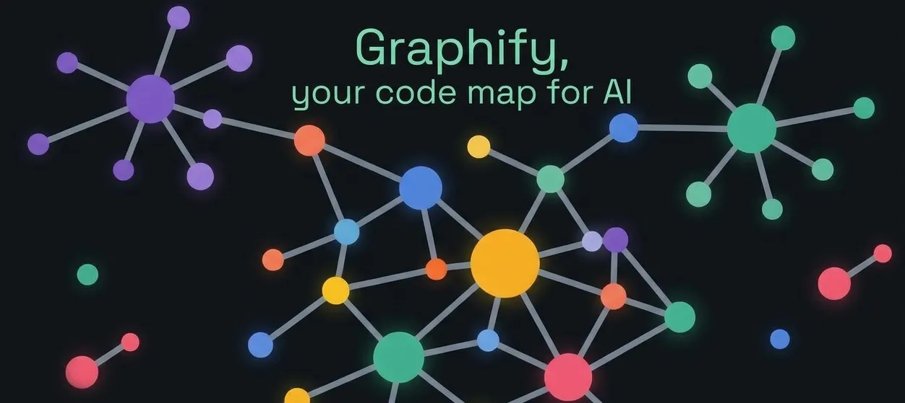

+++
title = "Graphify code graphs with OpenCode."
date = 2026-10-11
updated = 2026-10-11
description = "How to use Graphify, a free tool, with OpenCode to turn a programming project into a queryable knowledge graph and explore it from the browser."

[taxonomies]
tags = ["OpenCode", "AI", "Tools", "YouTube"]

[extra]
footnote_backlinks = true
+++

Hello developer 👋! In this post we generate a graph of a programming project to better understand how its pieces connect and give more context to an AI agent, without having to open file by file. We use [Graphify](https://github.com/Graphify-Labs/graphify), a free tool, together with OpenCode and one of its free models.

We see how to generate the graph, explore it from the browser, and query it with AI using commands like `explain`, `query` and `path`.



## What is Graphify

We are in the GitHub repository of Graphify, which has around 125 thousand stars, which is a lot. In its About section it says:

> Turn any codebase, with its docs, SQL schemas, configs, and PDFs, into a queryable knowledge graph. A /graphify skill for Claude Code, Cursor, Codex, and Gemini CLI: local deterministic AST parsing, every edge explained, no vector store.

In other words, it reads the code directly on your computer and breaks it down into its real pieces (functions, files, who calls whom) following fixed rules. Because of those fixed rules, if you run it twice you should get the same result, and that is why it says it is deterministic.

## Installing Graphify

For the practice I have a personal project called `bread-baron` open in the Zed code editor. We open a terminal and install Graphify:

```bash
uv tool install graphify
```

But notice that this gives an error, and that is because the name is written with a double "y". So we write the correct command:

```bash
uv tool install graphifyy
```

We are going to use the OpenCode AI agent, so we install the skill for it:

```bash
graphify install --platform opencode
```

Then we open OpenCode:

```bash
opencode
```

And we run the prompt:

```
/graphify .
```

At the end it gives us a summary of what it has done, and a directory is created with a `graph.html` file to see the graph.

## Reading the graph

Each point is a piece of the project: a function, a component, a hook, a config file, a design document, and so on. The bigger the point, the more connections it has. In this case, `useGameStore` is the biggest one because almost everything depends on it.

Each line is a relation between two pieces, for example "this function calls this other one", "this file imports that one" or "this document talks about this component". If you click a node and look at its neighbors, you can see what it connects to.

The communities are groups of nodes that are very connected to each other and little to the rest. They usually correspond to "zones" of the project. Each community has a color, and the number on the right shows how many nodes it contains. You can check and uncheck the boxes to see only one zone.

### A simple analogy

Think of a city map: the nodes are the buildings, the lines are the streets that join them, and the communities are the neighborhoods.

## Asking the graph with the AI

We go back to OpenCode and tell it "yes" so it traces the suggested question. The answer is that the store is very central, but it is well organized. It does not need to be broken into pieces; if anything, what could be improved is how the components consume it.

Then I run:

```
/graphify explain "Game Balance Constants"
```

In the answer we see that "Game Balance Constants" is not a file, but the name Graphify gave to a group of pieces that mixes the game numbers (costs, ranges) with the code that uses them. Because they are poorly connected to each other, it suggests separating them as an improvement.

Now I run:

```
/graphify query "which parts of the project handle saving the game?"
```

Graphify tells us the complete path of the game saving (who saves, who loads and who checks) without you having to open a single file.

Now, as it suggests, we trace a path with:

```
/graphify path "useAutoSave" "loadFromStorage"
```

Graphify showed that the auto-save and the game loading are only in `App.tsx`, and it did so with safe relations taken from the real code. The three jumps are marked as EXTRACTED with a confidence of 1.0. That means they come directly from the code and are not guesses. It is the perfect contrast with the INFERRED relation we saw before.

## Conclusion

Graphify turns a project into a graph you can explore and query, and it does so from the real code, without guessing. With a couple of commands you get a visual map of how the pieces connect, and the AI agent can answer questions like who saves the game or where a value is used, all without opening file by file. It is free and works well together with OpenCode.

## Video

In the following video you can see the complete process (Spanish audio).

{{ youtube_embed(video_id="47MjNLY9T44") }}
