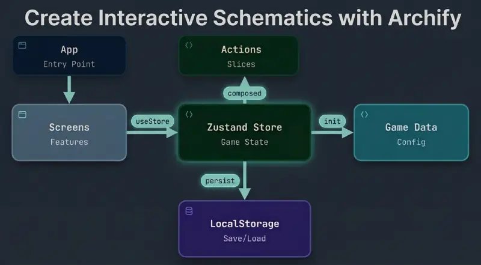

+++
title = "Archify diagrams with OpenCode."
date = 2026-10-25
updated = 2026-10-25
description = "How to use Archify, a free and open source tool, with OpenCode to turn an idea or the source code of an application into an interactive architecture diagram."

[taxonomies]
tags = ["OpenCode", "AI", "Tools", "YouTube"]

[extra]
footnote_backlinks = true
+++

Hello developer 👋! In this post we test [Archify](https://github.com/tt-a1i/archify), a free and open source tool that turns any idea or code into an interactive diagram using artificial intelligence. To do it we use OpenCode with a free model and create some architecture diagrams from the code of an application.



## What is Archify

Archify is a skill that an AI agent can use to draw diagrams. You describe what you want, or point the agent at a repository, and it generates an HTML file with an interactive diagram that you can open in the browser.

The interesting part is that the agent reads the real code before drawing, so the diagram shows the actual pieces of the project and not an invention.

## Installing the skill for OpenCode

For the practice I use a personal project called `bread-baron`. In Zed we open a large Git Bash terminal in the center.

We install Archify globally for OpenCode:

```bash
npx -y skills add tt-a1i/archify --skill archify --agent opencode --global --copy --yes
```

To check that it was installed correctly:

```bash
cd ~/.agents/skills/archify
```

```bash
node bin/archify.mjs doctor
```

We can go back to the previous directory with:

```bash
cd -
```

Now we open OpenCode:

```bash
opencode
```

You can check that the skill is there by opening `/skills` in OpenCode and typing `archify`, and it should appear.

## Generating a first diagram

Now we ask OpenCode:

```
Use Archify to draw: Browser -> API -> MySQL
```

Archify creates a `.archify` directory with the generated HTML. We open a small Git Bash terminal at the bottom and open the file. The `start` command is from Git Bash and is the same as double clicking the HTML file:

```bash
start .archify/architecture-navegador-api-mysql-20261014-105026/navegador-api-mysql.html
```

In the browser we can see the different tools that the interface has and navigate a little through the options.

## Generating a diagram from the source code

Now we generate another diagram, this time based on the source code:

```
Analyze this repository and use Archify to create a simple architecture diagram of this React application with Zustand, with a maximum of 10 components.
```

The diagram is clear and easy to read.

## Extending the diagram

Now we can ask OpenCode to extend the diagram and add the features that are in `src/features`:

```
Extend the architecture diagram of this application with Archify. Add the features from src/features connected to the Zustand store. Check in the code of each one if it only reads from the store or if it also calls actions, and draw the arrows in the correct direction. Maximum 12 components.
```

The result shows each feature next to the store, with the arrows pointing in the right direction depending on what the code really does.

## Conclusion

Archify turns an idea or a codebase into an interactive diagram without drawing anything by hand. With OpenCode and a free model you can start with a simple sketch like "Browser -> API -> MySQL" and then ask for a real diagram of your project, with its components, its store and its data flow. It is free, open source and works very well as a skill for an AI agent.

## Video

In the following video you can see the complete process (Spanish audio).

{{ youtube_embed(video_id="MLTp4YO44Zo") }}
