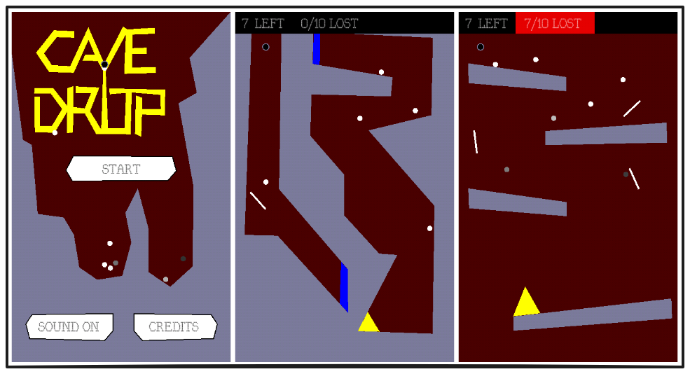

+++
title = "Cave drop"
description = "Guide balls through caves using physics and well-placed bars."
weight = 90

[extra]
local_image = "projects/cavedrop/logo.png"
category = "Games"
+++

**Cave Drop** is a 2D physics-based game with vector graphics, originally developed with Processing for desktop and Android. Now I'm porting it to the web with JavaScript and Matter.js. Place bars wisely to guide the balls to their final destination.

#### [GitHub](https://github.com/darellanodev/cave-drop) • [Try it online](https://darellanodev.github.io/cave-drop/) {.centered-text}

## Technologies

    
    
    
    
    
    
    

