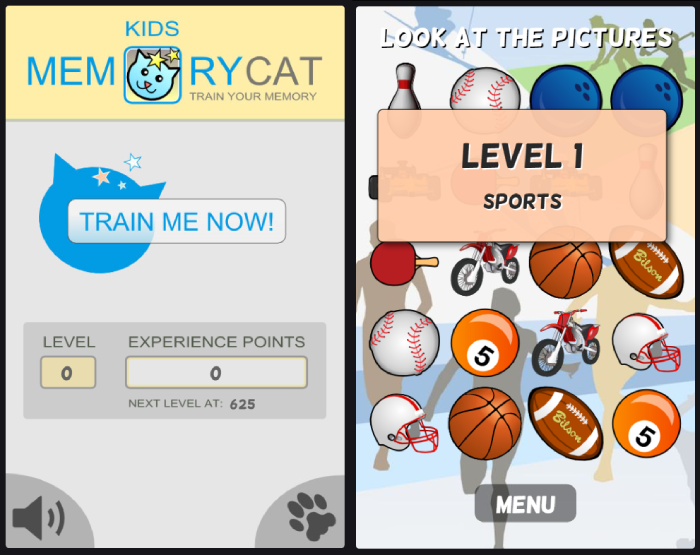

+++
title = "Memory kids cat"
description = "Train your memory with the cat."
weight = 85

[extra]
local_image = "projects/memorykidscat/logo.png"
category = "Games"
+++

**Memory Kids Cat** is a web memory game based on my 2014 Android game. It has different game modes: finding pairs against the clock, repeating sequences, and learning words in English, Spanish, French, and German. When you win, stars fly out of the cards and the cat moves to the next level on the map.

#### [GitHub](https://github.com/darellanodev/memory-kids-cat) • [Try it online](https://darellanodev.github.io/memory-kids-cat/) {.centered-text}

## Technologies

    
    
    
    
    
    

